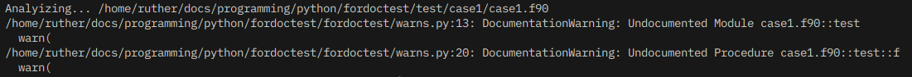

# fordoctest

Assure Fortran documentation consistency.

`fordoctest` uses [FORD](https://forddocs.readthedocs.io/) to parse a Fortran
project and reports entities that are missing documentation. It is the Fortran
counterpart of tools such as `pydoctest`.

## Installation

```bash
pip install fordoctest
```

For development:

```bash
python -m venv .venv
source .venv/bin/activate
pip install -r requirements_dev.txt
```

## Usage

```bash
fordoctest <ford_project_file> [ford_flags]
fordoctest <fpm.toml or fpm project directory>
```

Examples:

```bash
fordoctest doc/doc.md
fordoctest fpm.toml
fordoctest --max-modules 2 doc/doc.md
fordoctest --check-imperative doc/doc.md
```

FORD options such as `-d`, `-m`, `--exclude` and `--config` are forwarded to
FORD when a markdown project file is used. Run `fordoctest --help` for the
fordoctest-specific options.

### Exit codes

| Code | Meaning |
| --- | --- |
| 0 | All checks passed |
| 1 | At least one documentation issue was found |
| 2 | The project could not be loaded or the arguments were invalid |

Issues are written to standard error, one per line.

## Project configuration

For a FORD markdown project file, use the usual FORD metadata block:

```markdown
project: My project
src_dir: src
preprocess: false
```

For an fpm project, settings can be placed in the `[extra.ford]` table of
`fpm.toml`. Without that table, `fordoctest` checks the standard fpm source
directories (`src`, `app`, `test`, `example`, `examples` and `benchmark`).

## Checks

By default `fordoctest` reports:

- More than one module per source file (`--max-modules` changes the limit).
- Undocumented modules, submodules and programs.
- Undocumented file-level, module and program procedures.
- Undocumented procedure arguments.
- Undocumented derived types, type components and type-bound procedures.
- Undocumented interfaces.

Pass `--check-imperative` to additionally flag procedure documentation whose
first word is a clear third-person or non-imperative form (for example
"Computes..." instead of "Compute..."). This check is a conservative heuristic
and is disabled by default.

Example output:



## Limitations

- `fordoctest` depends on FORD's parser and project model.
- The imperative-verb check only uses a small English word list.
- Module-level variables and local variables inside procedures are not checked.
- There is no automatic documentation fixer.

## Development

```bash
black --check .
pytest --cov=fordoctest --cov-report=term-missing --cov-fail-under=90
python -m build
twine check dist/*
```

The test suite uses temporary FORD projects and does not require a Fortran
compiler because preprocessing is disabled in the fixtures.

### Beta checklist

- [x] Check the main Fortran entity kinds, including derived types,
      interfaces and submodules.
- [x] Include optional documentation restrictions (imperative verbs).
- [x] Test suite with at least 90% coverage.
- [ ] Become independent of FORD's CLI parser (not planned for 0.1).

## License

Mozilla Public License 2.0. See [LICENSE](LICENSE).
